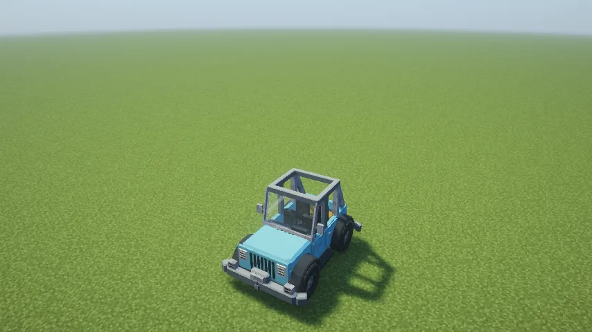
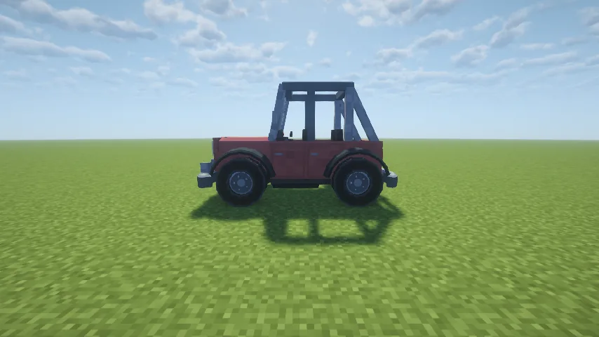
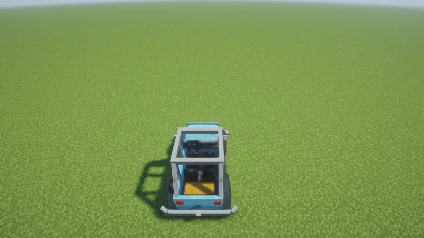
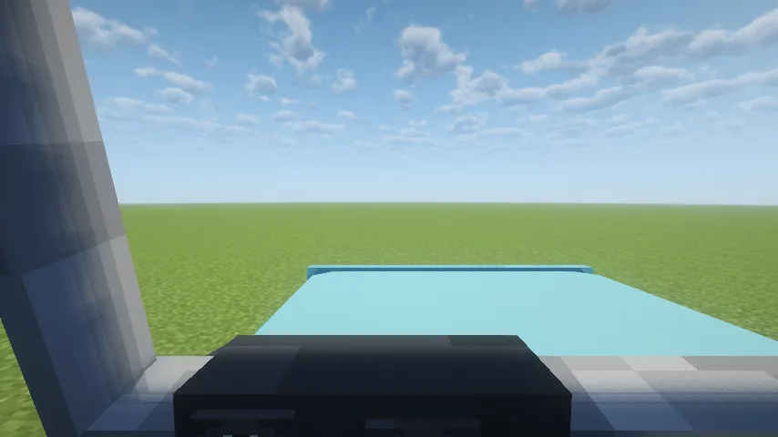
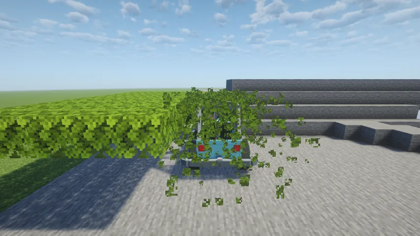
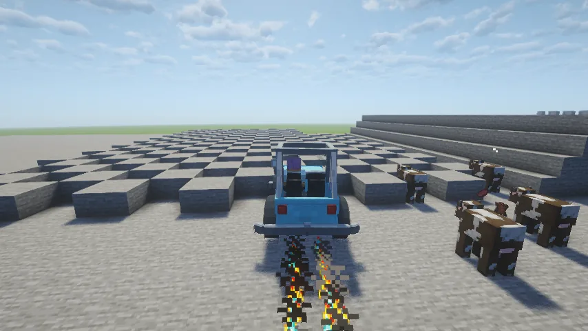
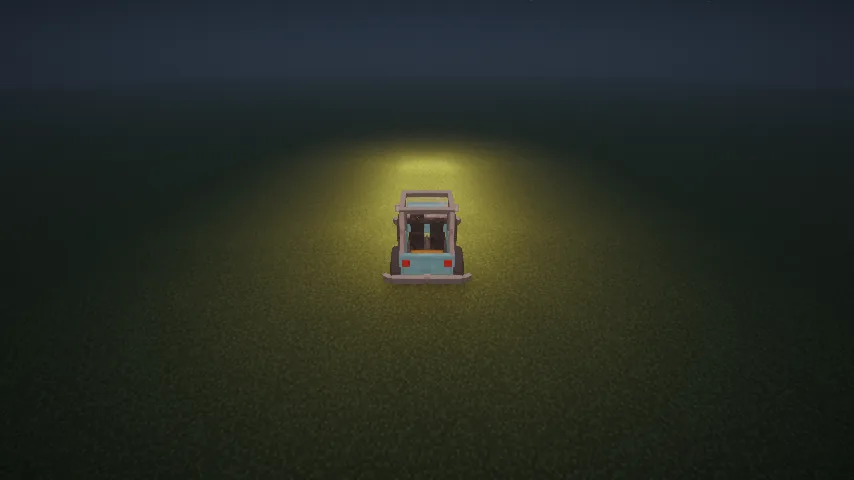

The **Trailblazer** is a four-door off-road pickup. It seats four, the driver on the left, and
carries a six-row double chest in its bed. It has a dash you can read from the driver's seat,
headlights, a horn, a radio for music discs, and a hitch for the [Trailer](/wiki/trailer).
Everything about driving it (fuel, drifting, keys, repairs, towing) is
[Vanilla Wheels](/wiki/vanilla-wheels)'s, so read that page too.

## Getting one

1. **The chassis:** nine steel blocks in a crafting grid. Steel comes from
   [Metals and Materials](/wiki/metals-and-materials) (an ingot is three iron and a coal).
2. **The parts:** four **wheels** and an **engine** (recipes on the
   [Vanilla Wheels](/wiki/vanilla-wheels#building-the-mechanic-lift) page).
3. **Build it** on a **Mechanic Lift**: put the chassis, wheels and engine in its slots and press
   **Build**. The truck appears on the deck. Put a dye in the lift and press **Paint** to colour it.
4. **Fuel it:** hold right-click at it with a full gas can.

## Driving it

- **Right-click** to get in (the driver's seat first); **crouch** to get out.
- **Movement keys** drive; hold **jump** in a turn to drift, and let go for a boost.
- **Left Control** is the horn; **H** cycles the headlights.
- Look down from the driver's seat: the two dials on the dash show your **speed** and your
  **fuel**.
- **The chest:** right-click the chest in the bed, or press your inventory key while riding.
- **Music:** crouch and right-click with a music disc to play it; crouch and right-click the dash
  empty-handed to take it out.
- **Towing:** back the rear hitch onto a [Trailer](/wiki/trailer)'s tongue.

## What it can do

| | |
|---|---|
| Top speed | 0.9 blocks a tick (18 m/s) |
| Drift boost | 1.16 blocks a tick for two seconds, afterburner lit |
| Climbs | one-block steps without jumping; a two-block ledge is a wall (use a ramp) |
| Size | 4⅔ blocks long, 1⅚ wide; the roll cage a little under 3 high |
| Clearance | the body is 1¾ blocks high, so it drives under a two-block canopy, the cage pushing through the leaves |
| Garage door | needs one three blocks high |
| Running something over at full speed | 11½ damage |

## Repairs

- **By hand:** right-click a damaged Trailblazer. A full rebuild costs 5 food points of hunger
  (2½ drumsticks).
- **On the Mechanic Lift:** a full repair costs **20 steel ingots**; a partial one less.

